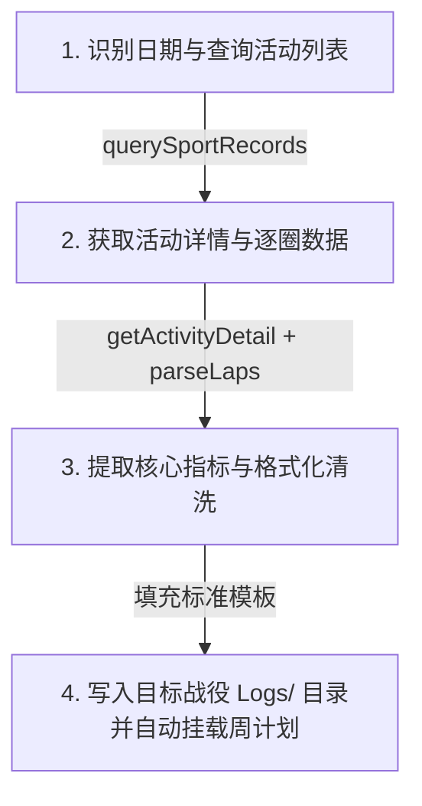

# 📥 Agent Skill 02: 高驰运动数据摄入与标准化日志生成

> **适用场景**：跑者完成跑步，提示“帮我导入今天的跑步记录”或“补录 YYYY-MM-DD 的运动”时，Agent 执行的标准工作流。

---

## 🧭 标准执行四步法



---

## 📌 第一步：调用 MCP 查询活动

1. 获取跑者指定日期（默认为今天）的开始与结束范围：`YYYYMMDD`。
2. 优先通过直连脚本或 MCP 工具调用 `querySportRecords`：
   ```bash
   node 04_Tools/COROS_MCP/coros-direct.js querySportRecords 20261020 20261020
   ```
3. 检查返回的 `sportRecordList`：
   - 获取关键字段：`labelId`（活动唯一ID）、`sportType`（运动类型：100=路跑，102=田径场等）、`distance`（米）、`duration`（秒）、`avgHr`、`trainingLoad`。

---

## 📌 第二步：获取详情与圈速 (Laps)

使用获取到的 `labelId` 调用：
```bash
# 获取活动全量统计详情
node 04_Tools/COROS_MCP/coros-direct.js getActivityDetail <labelId> <sportType>

# 获取分段/逐公里圈速
node 04_Tools/COROS_MCP/coros-direct.js parseLaps <labelId> <sportType>
```

---

## 📌 第三步：数据单位清洗与换算规则

* **距离**：返回值为米，需转换为千米（四舍五入保留2位小数）：`distance_km = round(distance / 1000, 2)`
* **平均配速**：
  - 如果返回平均速度 `speed`（米/秒），换算公式：`pace_seconds = 1000 / speed`；
  - 格式化为 `mm:ss`（例如 250 秒 $\to$ `04:10`）。
* **步频**：若返回步频，确认单位为 `spm`。
* **负荷与效果**：
  - `training_load`: 整数
  - `aerobic_te`: 有氧训练效果（0.0 ~ 5.0）
  - `anaerobic_te`: 无氧训练效果（0.0 ~ 5.0）

---

## 📌 第四步：生成标准 YAML 日志并落盘

落盘路径：`01_Seasons/当前活跃战役/Logs/YYYY-MM-DD-运动类型.md`。

### 标准 Markdown 结构范例：

```markdown
---
date: 2026-10-20
type: 跑步
distance_km: 12.05
avg_pace: "04:15"
avg_hr: 152
max_hr: 168
training_load: 135
aerobic_te: 3.8
anaerobic_te: 0.5
avg_power_w: 245
cadence_spm: 184
rpe: 6
knee_status: 0
target_cycle: "[[2026-W42]]"
tags:
  - 训练日志
  - 跑步
  - 有氧门槛
---

# 🏃 2026-10-20 跑步训练日志

> **挂载周计划**：[[2026-W42]]  
> **数据源**：COROS PACE 3 自动同步  

---

## 📊 一、 核心客观数据看板

| 距离 | 平均配速 | 平均心率 | 最高心率 | 平均步频 | 平均功率 | 训练负荷 | 有氧/无氧 TE |
| :---: | :---: | :---: | :---: | :---: | :---: | :---: | :---: |
| **12.05 km** | **04:15** | **152 bpm** | **168 bpm** | **184 spm** | **245 W** | **135** | **3.8 / 0.5** |

---

## ⏱️ 二、 逐公里分段详情 (Laps)

| 公里 | 分段配速 | 平均心率 | 平均步频 | 备注 |
| :---: | :---: | :---: | :---: | :--- |
| **1** | 04:30 | 138 | 180 | 热身起步 |
| **2** | 04:20 | 145 | 182 | 渐入节奏 |
| **3-11**| 04:12 | 154 | 185 | 稳态巡航 |
| **12**| 04:05 | 165 | 188 | 尾段适度冲刺 |

---

## 🩺 三、 主观体感与关节监测 (跑者可编辑)

- **自感用力程度 (RPE 1-10)**：`6` (中等偏吃力，呼吸可控)
- **下肢关节状态 (knee_status 0-3)**：`0` (无痛感，肌腱表现良好)
- **跑者主观心流记录**：
  > （在此记录今天的呼吸体感、天气感受、补给情况或路线心得）

---

## 👨‍🏫 四、 AI 数字化教练快速复盘

1. **代谢区间评估**：本次训练主要集中在 Zone 2 ~ Zone 3 之间，有氧刺激充分（TE 3.8），同时严格控制了无氧糖酵解，符合有氧基础构建逻辑。
2. **力学特征观察**：步频稳定在 184 spm，步频与配速匹配度极高，垂直振幅经济性良好。
3. **后续建议**：今日负荷适中，建议跑后补充 20-30g 蛋白质与适量水分，明日课表可按原计划推进。
```
