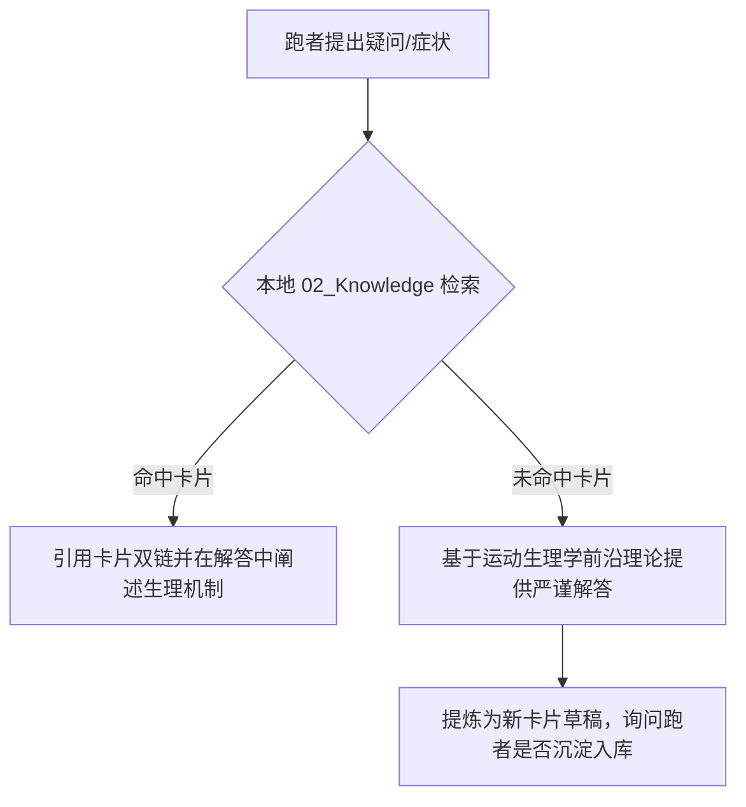

# 🔬 Agent Skill 05: 运动科学理论顾问与康复干预

> **适用场景**：跑者询问生理机制（如乳酸门槛、VLamax、触地时间）、跑步损伤（髌腱炎、跟腱酸痛）、或营养补充策略时，Agent 执行的标准指导流程。

---

## 📚 知识图谱检索逻辑

当跑者提出疑问时，Agent 不得给出宽泛的“多喝水多休息”套话，而应优先检索本地 `02_Knowledge/` 知识卡片，并遵循循证运动科学原则：

---

## 🩹 核心伤病干预标准协议

### 1. 膝关节与髌腱酸痛干预：
* **理论支撑**：Keith Baar 教授的《肌腱胶原蛋白重塑与等长抗阻协议》。
* **核心认知**：肌腱对动态冲击敏感，但对**长时间静止等长收缩（Isometric Loading）**产生极佳的机械转导修复信号，且能抑制神经疼痛传导。
* **行动建议**：
  - 暂时规避室外硬地大下坡和高步幅冲刺；
  - 练习**单腿靠墙静蹲（Wall-Sit）**或**坐姿抗阻等长伸膝**（每次维持 45 秒，间歇 2 分钟，重复 4~5 组）；
  - 练习前 30-60 分钟补充 10-15g 水解胶原蛋白肽 + 50mg 维生素 C。

### 2. 跟腱与足底筋膜酸痛干预：
* **理论支撑**：Alfredson 离心加重提踵与慢速重阻（HSR）。
* **行动建议**：
  - 台阶边缘慢速提踵（3秒上升，2秒顶峰停顿，3秒缓慢下放至水平面以下）；
  - 避免赤足行走硬质地面，跑步换用落差（Drop）稍大的缓震跑鞋减缓跟腱牵拉。

---

## 🧪 经典运动科学理论库速查

* **乳酸不是疲劳元凶**：乳酸（Lactate）是人体极佳的高效能量中间体，真正的疲劳酸中毒来源于伴随 ATP 水解产生的氢离子（$H^+$）。
* **MCT1 与 MCT4 转运体**：通过临界门槛巡航间歇，能够上调快肌纤维排出乳酸的 MCT4 以及慢肌与心肌摄取乳酸燃烧的 MCT1 蛋白表达，大幅提高“乳酸穿梭”再利用能力。
* **Billat 30-30 微间歇**：30秒 $v\text{VO}_2\max$ + 30秒 50% 速度慢跑，兼具极长的高摄氧刺激时间与极低的酸中毒累积，是耐力运动员最高效的赛季强化武器。
