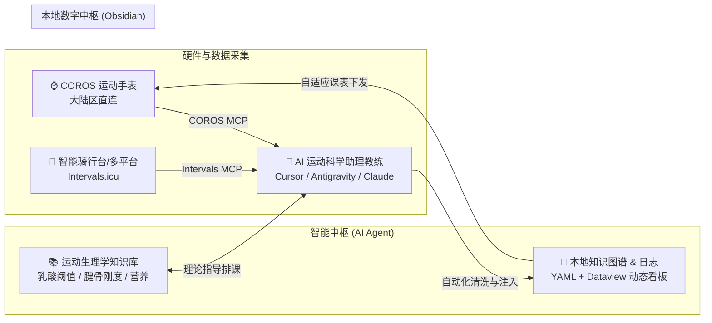

# 🏃‍♂️ Agent-Runner-Kit
### AI 智能体驱动的个人耐力运动科学训练中枢

[简体中文](README.md) · [English](README_EN.md) · [日本語](README_JA.md)

> **开源理念**：将顶级运动员的“运动科学理论 + 客观穿戴数据 + 周期化监控 + 主观体感反思”闭环，通过 **AI Agent + MCP 网关 + Obsidian 本地知识库** 落地给每一位严谨的严肃跑者与耐力运动爱好者。

---

## 🌟 为什么做这个项目？

传统严肃耐力训练中，跑者面临三大断层：
1. **数据与洞察断层**：高驰（COROS）手表或骑行台记录了极其详尽的客观流（配速、心率、功率、步频、HRV），但数据散落在 App 闭环内，跑者无法跨周期灵活统计；尤其是**大陆区高驰接口**缺乏开箱即用的 AI 接入方案。
2. **体感与客观脱节**：手表不知道你昨天膝盖微酸，也不知道你今天工作压力爆表。主客观无法在同一个看板中产生联动。
3. **理论与排课脱节**：学了很多“挪威双门槛”、“极化训练”、“Keith Baar 腱骨等长重塑”，但到了周一依然不知道今天该跑什么配速、什么间歇时长。

**Agent-Runner-Kit** 彻底打破这些断层：

---

## 📦 仓库核心内容导航

| 模块 / 路径 | 核心作用 | 适用对象 |
| :--- | :--- | :--- |
| **[`check_environment.js`](./check_environment.js)** | **🩺 一键环境诊断脚本**：快速检查 Node 版本、物理网卡、COROS凭证与 Intervals 安装状态 | **所有新用户（建议首跑）** |
| **[`AGENT_BOOTSTRAP.md`](./AGENT_BOOTSTRAP.md)** | **⭐ 核心启动引导**：复制这句话给你的 AI Agent，让 Agent 成为你的私人装机顾问，交互式帮你建仓 | **所有跑者（推荐首选）** |
| **[`01_Agent_Skills/`](./01_Agent_Skills/)** | 赋予 AI Agent 运动科学与排课能力的技能提示词规范（Prompts/Skills/Rules） | AI 智能体 / 进阶开发者 |
| **[`02_MCP_Setup/`](./02_MCP_Setup/)** | **高驰大陆区 MCP 网关方案**（绕过代理直连） + **Intervals.icu 接入脚本** | 环境配置与网络打通 |
| **[`03_Vault_Skeleton/`](./03_Vault_Skeleton/)** | 干净、无私人信息的 Obsidian 仓库骨架（看板、模板、赛季架构、精选知识卡片） | 跑者直接作为 Vault 打开 |
| **[`04_User_Manual.md`](./04_User_Manual.md)** | 面向跑者人类的日常操作使用手册与高频一键提示词锦囊 | 跑者日常训练使用 |
| **[`CONTRIBUTING.md`](./CONTRIBUTING.md)** | 社区贡献者指南：如何提交知识卡片、新硬件连接器或多语言文档 | 开发者与贡献者 |

---

## 🚀 极速上手：两种开启方式

### 方式 A：AI Agent 交互式全自动构建（推荐 ⭐⭐⭐⭐⭐）

你不需要手动去改各种复杂的配置文件！只要你拥有支持 MCP 和文件读写能力的 AI 编程工具（如 **Cursor**、**Antigravity**、**Claude Code**、**Cline**、**Windsurf** 等）：

1. 将本仓库克隆或下载到本地。
2. 用你的 AI 编程助手打开当前目录。
3. **直接把下面这句话发给 AI**：
   > 💬 **“你好！请仔细阅读 `AGENT_BOOTSTRAP.md`，作为我的首席运动科学家，引导我一步步构建我的个人科学跑步中枢仓库。”**
4. 你的 AI 就会像私人教练一样，一步步向你询问：
   - 你的称呼与主攻项目（全马/半马/1500m/10K 等）；
   - 你的当前最好成绩（PB）与目标赛季；
   - 协助你配置高驰（COROS 大陆区）与 Intervals.icu 账号；
   - 自动生成属于你的个人档案、战役课表与 Dataview 看板！

---

### 方式 B：手动快速移植

1. **直接提取仓库骨架**：将 [`03_Vault_Skeleton/`](./03_Vault_Skeleton/) 目录下的所有文件复制到你的新建 Obsidian 库中；
2. **安装 Obsidian 核心插件**：
   - `Dataview`（必装，驱动所有动态看板与周负荷统计）
   - `Calendar`、`Tag Wrangler`（推荐）
3. **配置 MCP 工具**：参考 [`02_MCP_Setup/`](./02_MCP_Setup/) 完成 COROS 与 Intervals.icu 的环境配置；
4. **填入个人档案**：编辑 `00_Dashboard/个人档案与训练基线.md`，开始你的科学训练之旅！

---

## 💡 核心设计原则

1. **本地优先（Local-First）与数据主权**：所有训练日记与知识沉淀均为 Markdown 纯文本，永久属于你自己，无任何云端商业锁死。
2. **主客观双向纠偏**：拒绝唯心率/配速论，把疲劳、睡眠、膝关节/跟腱酸痛度（`knee_status`）纳入决策第一优先级。
3. **科学理论武装到牙齿**：课表不再是凭空拍脑袋，每堂间歇课、阈值课都链接至具体的生理学机制（乳酸穿梭、微间歇低酸保护、腱骨等长修复）。

---

## 📄 开源许可证

本项目基于 [MIT 许可证](LICENSE) 开源。欢迎每一位耐力运动爱好者 Star、Fork 并贡献你的运动科学知识卡片！
