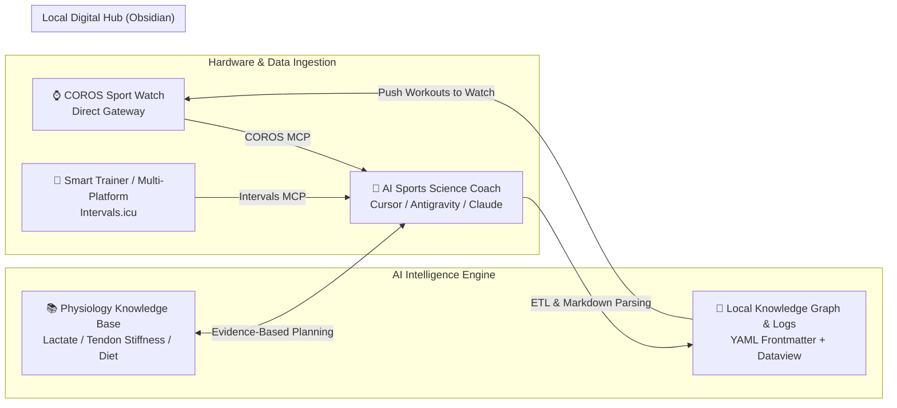

# 🏃‍♂️ Agent-Runner-Kit
### AI-Driven Personal Endurance Training & Sports Science Hub

[English](README_EN.md) · [简体中文](README.md) · [日本語](README_JA.md)

> **Core Philosophy**: Bridge the gap between elite sports science and everyday training. By combining **AI Agents + MCP Gateways + Obsidian Local Knowledge Graph**, this project creates a full closed-loop system integrating **Exercise Physiology $\to$ Wearable Objective Telemetry $\to$ Subjective RPE & Joint Monitoring $\to$ Adaptive Periodized Scheduling**.

---

## 🌟 Why Agent-Runner-Kit?

In serious endurance sports (running, cycling, triathlon), athletes constantly face three painful disconnects:
1. **The Telemetry Silo**: Wearable devices (COROS, Garmin, Apple Watch, smart trainers) log rich high-frequency data (HR, pace, power, cadence, HRV), but data remains trapped in vendor apps. It cannot be freely cross-analyzed across training macrocycles.
2. **Subjective vs. Objective Disconnect**: Your watch has no idea if your patellar tendon feels tight, or if work stress peaked yesterday. Objective metrics and subjective readiness rarely talk to each other in one holistic dashboard.
3. **Theory vs. Execution Gap**: You read about Norwegian Double Thresholds, Polarized Training (TID), and Keith Baar's isometric tendon protocols—yet on Monday morning, you still don't know what exact pace and interval duration to run.

**Agent-Runner-Kit eliminates these barriers:**

---

## 📦 Directory Structure & Component Guide

| Module / Path | Purpose | Target Audience |
| :--- | :--- | :--- |
| **[`check_environment.js`](./check_environment.js)** | **🩺 One-Click Diagnostics Script**: Verifies Node.js, physical network interface, COROS token, and Intervals setup. | **All New Users (Recommended First Step)** |
| **[`AGENT_BOOTSTRAP.md`](./AGENT_BOOTSTRAP.md)** | **⭐ Core Onboarding Protocol**: Feed this file to your AI Agent to have it interactively build your personal training hub from scratch. | **All Runners (Recommended)** |
| **[`01_Agent_Skills/`](./01_Agent_Skills/)** | System prompts, execution rules, and sports science decision frameworks for AI agents. | AI Agents / Developers |
| **[`02_MCP_Setup/`](./02_MCP_Setup/)** | Configuration, direct-connect gateway scripts (bypassing proxies for COROS China/Global), and Intervals.icu setup. | Environment Setup |
| **[`03_Vault_Skeleton/`](./03_Vault_Skeleton/)** | Clean, anonymized Obsidian vault template (master dashboard, sample campaign, atomic physiology cards, templates). | Direct Obsidian Vault |
| **[`04_User_Manual.md`](./04_User_Manual.md)** | Daily 5-minute human runner manual & one-click AI prompt cheatsheet. | Daily Runner Workflows |
| **[`CONTRIBUTING.md`](./CONTRIBUTING.md)** | Contribution guide: How to add sports science cards, new hardware connectors, and docs. | Contributors |

---

## 🚀 Quickstart: Two Ways to Get Started

### Method A: Interactive Automated Setup via AI Agent (⭐⭐⭐⭐⭐ Recommended)

You do **not** need to manually edit complicated config files! If you have an AI coding assistant with MCP and file-system capabilities (e.g., **Cursor**, **Antigravity**, **Claude Code**, **Cline**, **Windsurf**):

1. Clone or download this repository locally.
2. Open this folder in your AI assistant.
3. **Send this single prompt to your AI**:
   > 💬 **"Hi! Please read `AGENT_BOOTSTRAP.md` carefully. Act as my Chief Sports Scientist & Setup Consultant, and guide me step-by-step to build my personal endurance training hub."**
4. Your AI coach will interactively prompt you for:
   - Your preferred name and primary race target (Marathon / Half Marathon / 10K / 1500m);
   - Your current Personal Bests (PBs) and baseline training zones;
   - Assist you in setting up COROS and/or Intervals.icu credentials;
   - Automatically generate your profile, first campaign structure, and dynamic Dataview dashboards!

---

### Method B: Manual Vault Import

1. **Extract the Skeleton**: Copy everything inside [`03_Vault_Skeleton/`](./03_Vault_Skeleton/) into a new folder and open it as an Obsidian Vault;
2. **Install Obsidian Community Plugins**:
   - `Dataview` (Required: powers dynamic dashboards and weekly load rollups);
   - `Calendar` / `Tag Wrangler` (Recommended);
3. **Configure MCP Connectors**: Follow [`02_MCP_Setup/`](./02_MCP_Setup/) to connect your hardware telemetry;
4. **Fill In Baselines**: Update `00_Dashboard/个人档案与训练基线.md` with your parameters and begin logging!

---

## 💡 Core Design Principles

1. **Local-First & Data Sovereignty**: All workouts, physiological insights, and training logs are saved as plain Markdown files with YAML frontmatter. Permanent ownership, zero vendor lock-in.
2. **Bidirectional Subjective & Objective Feedback**: Heart rate and pace never tell the full story. Subjective RPE, sleep quality, and joint status (`knee_status`) are treated as first-class constraints.
3. **Grounded in Modern Exercise Physiology**: Every scheduled session directly links to underlying physiological mechanisms (Lactate Shuttle, MCT1/4 transporters, Billat 30-30 micro-intervals, Isometric tendon reloading).

---

## 📄 License

This project is licensed under the [MIT License](LICENSE). Contributions, feedback, and sports science knowledge cards from the endurance community are warmly welcomed!
