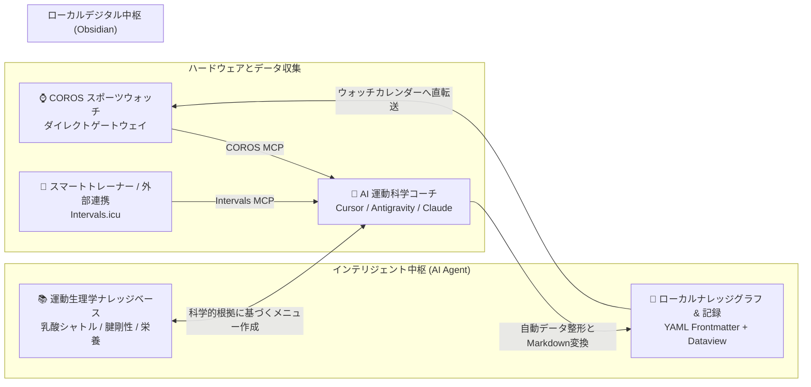

# 🏃‍♂️ Agent-Runner-Kit
### AIエージェント駆動型パーソナル持久力科学トレーニングハブ

[日本語](README_JA.md) · [English](README_EN.md) · [简体中文](README.md)

> **プロジェクトの理念**：トップアスリートが実践する「運動生理学理論 ＋ 客観的ウェアラブルデータ ＋ 期分け（ピリオダイゼーション）管理 ＋ 主観的自覚度（RPE/痛み）トラッキング」の循環構造を、**AI エージェント ＋ MCP 連携 ＋ Obsidian ローカルナレッジベース**を通じて、すべてのシリアスランナーおよび持久系アスリートに提供します。

---

## 🌟 開発の背景と課題解決

シリアスな持久系トレーニングにおいて、多くのランナーは3つの「分断」に直面しています：

1. **データと洞察の分断**：COROSなどのGPSウォッチやスマートトレーナーは高精度の客観データ（ペース、心拍数、パワー、ピッチ、HRV）を記録しますが、アプリ内部に閉じ込められており、長期的な統合分析が困難です。
2. **客観データと主観的体感の乖離**：デバイスは「膝蓋腱の違和感」や「昨夜の精神的ストレス」を完全には把握できません。主観と客観が同一のダッシュボードで連動していません。
3. **理論と日々の練習計画の乖離**：「ノルウェー式ダブル閾値」「極化（ポラライズド）トレーニング」「Keith Baar 式腱アイソメトリック強化」を学んでも、月曜日の朝に「具体的にどんなペースとレスト時間で走るべきか」を即座に落とし込めません。

**Agent-Runner-Kit は、これらの分断を完全に解消します：**

---

## 📦 リポジトリ構成一覧

| モジュール / パス | 概要 | 対象 |
| :--- | :--- | :--- |
| **[`check_environment.js`](./check_environment.js)** | **🩺 ワンクリック環境診断スクリプト**：Node.js、物理ネットワーク、COROSトークン、Intervalsの構成を自動判定。 | **全新規ユーザー（実行推奨）** |
| **[`AGENT_BOOTSTRAP.md`](./AGENT_BOOTSTRAP.md)** | **⭐ コア初期化プロトコル**：このファイルをAIエージェントに読み込ませるだけで、対話形式で自動構築してくれます。 | **全ランナー（推奨）** |
| **[`01_Agent_Skills/`](./01_Agent_Skills/)** | AIエージェントに運動科学とメニュー作成の専門性を持たせるスキル定義（プロンプト・ルール）。 | AIエージェント / 開発者 |
| **[`02_MCP_Setup/`](./02_MCP_Setup/)** | COROSウォッチおよび Intervals.icu（スマートトレーナー）との接続スクリプト・設定ガイド。 | 環境構築 |
| **[`03_Vault_Skeleton/`](./03_Vault_Skeleton/)** | 個人情報を除外したクリーンな Obsidian テンプレート（統合ダッシュボード、期分け設計、科学カード）。 | Obsidian 保管庫 |
| **[`04_User_Manual.md`](./04_User_Manual.md)** | ランナーのための1日5分クイック操作ガイド＆コピペで使えるAIプロンプト集。 | 日常の練習管理 |
| **[`CONTRIBUTING.md`](./CONTRIBUTING.md)** | コミュニティ貢献ガイド：科学カードの追加、新ハードウェアコネクタ、ドキュメント改善。 | 開発者・コントリビューター |

---

## 🚀 クイックスタート：2つの始め方

### 方法 A：AI エージェントによる対話型自動セットアップ（⭐⭐⭐⭐⭐ 推奨）

複雑な設定ファイルを手動で編集する必要はありません。MCPとファイル読み書きに対応したAIツール（**Cursor**、**Antigravity**、**Claude Code**、**Cline**、**Windsurf** など）をお使いの場合：

1. 本リポジトリをローカルにクローンまたはダウンロードします。
2. AI コーディングツールでこのフォルダを開きます。
3. **以下のプロンプトをAIに送信してください**：
   > 💬 **「こんにちは！`AGENT_BOOTSTRAP.md` を読み込んで、私の専属スポーツサイエンティストとして、自分専用の科学的ランニング管理リポジトリを対話形式で構築してください。」**
4. AIがあなたの専属コーチとして以下をヒアリングし、自動構築します：
   - お名前・ターゲット種目（フルマラソン / ハーフ / 10km / 1500m など）；
   - 自己ベスト（PB）と目標心拍・ペースゾーン；
   - COROS や Intervals.icu の連携認証；
   - あなた専用の個人プロファイル、シーズン期分け、Dataview 動的ダッシュボードの自動生成！

---

### 方法 B：Obsidian 手動インポート

1. [`03_Vault_Skeleton/`](./03_Vault_Skeleton/) 内のすべてのファイルを新しい Obsidian Vault フォルダにコピーします。
2. Obsidian の推奨コミュニティプラグインを有効化します：
   - `Dataview`（必須：動的集計ダッシュボードを表示）
   - `Calendar`（推奨）
3. [`02_MCP_Setup/`](./02_MCP_Setup/) を参考に、お手持ちのデバイスとMCPを接続します。
4. `00_Dashboard/个人档案与训练基线.md` に数値を入力し、トレーニングを開始します。

---

## 💡 設計のコア原則

1. **ローカルファースト（Local-First）とデータ主権**：すべての記録は標準的な Markdown（YAML Frontmatter）で保存されます。クラウドサービスの仕様変更やサービス終了のリスクなく、一生涯の資産になります。
2. **主観と客観の二方向補正**：心拍数やペースの数字だけを盲信せず、自覚的運動強度（RPE）や関節・腱の違和感（`knee_status`）を最優先の停止基準とします。
3. **運動生理学に根ざしたメニュー**：練習メニューは経験則だけでなく、乳酸シャトル（MCT1/4）、Billat 30-30 微小インターバル、Keith Baar 腱リモデリングなどの生化学的根拠に直結しています。

---

## 📄 ライセンス

本プロジェクトは [MIT License](LICENSE) のもとで公開されています。ランナーの皆様からのフィードバックや知見の共有を心よりお待ちしております！
